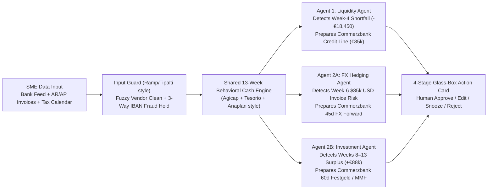

# Autonomous CFO — Product Concept, Market Synthesis & Detailed Application Design

## 1. The Core Idea & Innovation

### Problem Statement
> *"How might we use AI to help SMEs manage their finances proactively through intelligent, autonomous financial decision support and automation?"*

SME owners (*Mittelstand* founders and 1–2 person finance teams) operate with **backward-looking bookkeepers** and **present-day bank balances**, but **zero forward-looking CFO intelligence**. Meanwhile, the global fintech market is split into 5 expensive, disconnected silos (Spend/AP, Cash/Treasury, FP&A Modeling, Financial Close, and SME Neobanks).

### Our Solution: "Calm Glass-Box Autonomous CFO"
We design an **intelligent, zero-migration CFO decision and automation layer** that connects to an SME's existing accounts, invoices, and spreadsheets, runs privately on **Red Hat OpenShift AI (`vLLM`)**, and translates raw financial data into **ready-to-approve Commerzbank actions** (*Revolving Credit Facilities, FX Forwards, and Fixed-Term Deposits*) weeks before a problem or opportunity occurs.

> **Core Product Mantra:** **Predict → Explain → Simulate → Prepare (Never Send Without Human Approval).**

---

## 2. How We Combine the Winning Features of the 18 Analyzed Platforms

Instead of reinventing the wheel or building a bloated enterprise suite, we extract the **most valuable 20% from each market leader** and fuse them into a single cohesive workflow:

| What We Build in Our App | Proven Market Source | Why It Is Innovative & Practical for SMEs |
| :--- | :--- | :--- |
| **1. Behavioral 13-Week (90-Day) Cash Flow Horizon** | **Agicap** (Open Banking cash view) + **HighRadius / Tesorio** (AR customer payment-delay prediction) | Standard cash charts assume invoices are paid on their due date. Our engine automatically shifts expected customer inflows using each client's real historical payment delay (e.g., *"+16 days late"*), exposing hidden cash crunches **3–4 weeks early**. |
| **2. Hybrid Architecture: Deterministic Math + OpenShift AI Reasoning** | **Anaplan** (Deterministic core + Agent Studio) + **cfo.ai** (*Reambase* engine) | Eliminates AI math hallucinations 100%. A deterministic calculation core computes every euro (balances, shortfalls, interest, FX exposure, deposit yield), while the **Red Hat OpenShift AI (`vLLM`)** model handles context reasoning, plain-language Q&A, and explanations. |
| **3. Natural-Language "What-If" FP&A Simulator** | **cfo.ai (Ari)** + **Pigment / Drivetrain** | No spreadsheet formulas required. The business owner asks in plain language: *"What happens if Client KronoStahl delays €48,000 by 30 days?"* or *"Can we hire 1 engineer at €5,500/mo if USD rises 8%?"* — and sees the **Simulated Cash Curve** overlaid live on the baseline chart. |
| **4. Source-Linked "Flux" Explanations** | **Numeric** (Agentic Flux Analysis) + **Ramp** (Source-linked citations) | Every weekly cash dip and every AI recommendation cites the exact underlying documents (*"Week 4 drops to -€18,450 because Payroll €58.5k + Q4 VAT €29.4k collide while Invoice INV-AR-402 is delayed"*). |
| **5. Plain-English Financial Guardrails** | **Ramp / Brex** (AI Policy Agents) | Owners configure rules in natural language (*"Always protect a €60,000 minimum cash buffer; propose short-term investments only when surplus exceeds €75,000 for 45+ days"*). |
| **6. Pre-Forecast 3-Way AP Fraud Quarantine** | **Ramp / Tipalti / BILL** (3-way PO matching & IBAN verification) | Before an uploaded supplier invoice enters scheduled outflows, the system checks it against the Purchase Order and Master Vendor directory—automatically quarantining invoices with **altered bank IBANs** or unauthorized price hikes. |
| **7. Pre-Packaged Commerzbank Product Execution ("Prepare, Never Send")** | **Kyriba** (FX & Liquidity structuring) + **Commerzbank SME Products** | Instead of passive warnings, agents structure the exact financial instrument (**Commerzbank Revolving Credit Line, FX Forward, or 60-Day Festgeld**) with pre-calculated cost vs. benefit in `€`, waiting for a single human **Approve** click. |

---

## 3. Focused Multi-Agent Workflow Design (Challenge Card Use Cases)

Following the [Challenge Card - Autonomous CFO.pdf](file:///d:/collabothon/Challenge%20Card%20-%20Autonomous%20CFO.pdf) requirement to select at least one (or a tightly connected pair) of the core use cases and demonstrate the full end-to-end flow, our app is built around **1 Shared 13-Week Cash Engine** driving **2 Core Agents (+ 1 Surplus Extension on the same curve)**:

### Detailed Breakdown of the 4 Mandatory Autonomy Levels per Agent

| Agent | 1. What It Analyzes Independently | 2. What It Recommends (Explainable Logic) | 3. What Requires User Approval | 4. Execution Mode (Simulated vs. Permitted) |
| :--- | :--- | :--- | :--- | :--- |
| **Agent 1: Liquidity Agent** *(Core Anchor)* | Consolidates bank balance (`€142.5k`), payroll (`€58.5k`), Q4 tax advance (`€29.4k`), and open receivables. Shifts *KronoStahl AG* `€48k` invoice by `+16 days` based on payment history, uncovering a **Week-4 `-€18,450` cash shortfall**. | Proposes a **Commerzbank 30-Day Revolving Credit Facility draw of `€85,000` at `5.25% p.a.`** to keep cash above the `€60k` buffer. Proves that **`€366.78` interest** saves **`€4,250.00`** in supplier late fees and preserved *Skonto* discounts (**Net gain: `+€3,883.22`**). | Owner must review and click **Approve Credit Drawdown** (or adjust the amount slider / reject). | **Analysis:** Permitted live. **Credit Drawdown:** **Simulated Commerzbank Credit API** (triggers only after user approval). |
| **Agent 2A: FX Hedging Agent** *(Commerzbank Special)* | Scans incoming bills and flags foreign invoice **`INV-USD-2026-771` (`$85,000 USD`)** due in 45 days (Week 6) against `EUR` revenue. Calculates that a `6%` USD rise adds **`+€4,998.89`** in unbudgeted cost. | Structures a **Commerzbank 45-Day FX Forward** locking `EUR/USD` at `1.0825` (`€78,521.94` fixed cost, `€0` upfront fee), compared side-by-side with an **FX Call Option** (`€640` premium). | Owner chooses **FX Forward** or **FX Option** and clicks **Approve Hedge**. | **Exposure Math:** Permitted live. **FX Contract Booking:** **Simulated Commerzbank FX Treasury API**. |
| **Agent 2B: Investment Agent** *(Surplus Side of Same Curve)* | Tracks the post-crunch recovery in **Weeks 8–13** (after big customer invoices settle and Q4 taxes are paid), identifying **`€88,000` in idle liquidity** sitting above the `€60,000` safety buffer for 60+ days. | Recommends sweeping **`€80,000`** into a **Commerzbank 60-Day Fixed-Term Deposit (*Festgeld* at `3.65% p.a.`)** or **Money Market Fund (`3.85% p.a.`)**, generating **`+€480 to +€506`** in risk-free yield. | Owner selects product & amount and clicks **Approve Placement**. | **Surplus Detection:** Permitted live. **Deposit Sweep:** **Simulated Commerzbank Deposit API**. |
| **Input Guard: AP 3-Way Fraud Agent** *(Data Hygiene Layer)* | Matches uploaded supplier invoice `INV-2026-994` (`€16,488`) against Purchase Order `PO-2026-118` (`€14,400`) and verified Master Vendor IBANs. Flags an **unverified foreign IBAN (`LT60...` vs `DE89...`)** and a **`+14.5%` price hike**. | Places the invoice in immediate **Defensive Quarantine** so fraudulent outflows don't distort the cash forecast, and recommends out-of-band vendor phone verification. | Owner must explicitly click **Confirm Fraud Hold** or **Override with Dual Verification**. | **Internal Quarantine Hold:** **Permitted Autonomous Defensive Action**. **Payment Release:** Hard-blocked without human override. |

---

## 4. End-to-End User Journey & Demo Storyboard

1. **Step 1 — Zero-Friction Data Input & Automatic Hygiene:**
   - The SME owner connects their bank feed / uploads their ledger CSV and a new supplier invoice PDF.
   - The app automatically merges messy duplicate vendor names (`"AWS EMEA SARL"` + `"Amazon Web Services *Cloud"` → `"Amazon Web Services"`), removes duplicate rows, quarantines the suspicious IBAN-altered invoice, and displays a **`96.8% Data Hygiene Score`**.
2. **Step 2 — Proactive 13-Week Horizon & Flux Discovery:**
   - The main dashboard renders the **13-Week Cash Horizon Chart** alongside a plain-language summary banner.
   - The owner immediately sees the **Week-4 Red Zone (`-€18,450`)**, clicks on Week 4, and reads the **AI Flux explanation** citing the exact three outflows and the delayed *KronoStahl* invoice.
3. **Step 3 — Interactive "What-If" Simulation:**
   - The owner asks in the What-If bar: *"What if KronoStahl delays payment by 30 days AND the USD strengthens by 6%?"*
   - The dashed **Simulated Curve** updates immediately, showing the Week-4 dip deepening and Week-6 USD costs rising.
   - The owner then toggles ***"Simulate with Recommended Commerzbank Credit Line + FX Forward"*** on the chart—and watches the curve stabilize smoothly above the `€60,000` safety buffer across all 13 weeks.
4. **Step 4 — Transparent Human Approval & Governance Proof:**
   - The owner reviews the **Liquidity Agent** and **FX Hedging Agent** cards, inspects the **4 Autonomy Levels**, clicks **"Inspect Anonymized AI Prompt"** (confirming that sensitive company names and IBANs were masked as `CLIENT_REF_001` and `IBAN_TOK_8821` before reaching `vLLM`), and clicks **Approve**.
   - The system generates a **Simulated Commerzbank Execution Receipt** protected by a SHA-256 idempotency key and logs the decision in the **Tamper-Evident EU AI Act Audit Ledger**.
